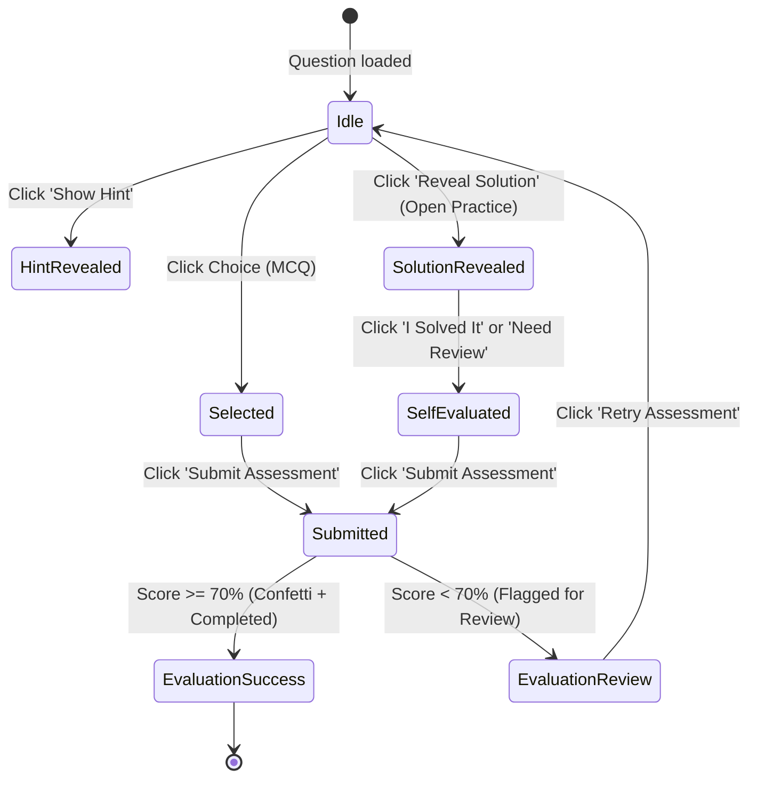

# LearnersGuide: UI/UX Design System & Architectural Specification

> **Platform Designation**: LearnersGuide — Modern Productivity Knowledge & Assessment Workspace  
> **Target Audience**: Software Engineers, Technical Students, Knowledge Workers, Professional Learners  
> **Design Persona**: Senior Product Designer, Design Systems Architect, UX Strategist  
> **Reference Inspirations**: Notion, Linear, Stripe Documentation, Vercel Dashboard, Obsidian, GitBook

---

# SECTION 1: CORE DESIGN PHILOSOPHY & EMOTIONAL TONE

LearnersGuide is engineered as a **calm, high-density knowledge workspace** rather than a consumer e-learning platform. It strips away all commercial LMS tropes (marketing banners, gamified cartoon badges, flashing animations, and neon gradients) in favor of **typographic restraint, cognitive clarity, and sustained reading endurance**.

```text
┌─────────────────────────────────────────────────────────────────────────────┐
│                           THE LEARNING FLYWHEEL                             │
│                                                                             │
│   ┌────────────────┐      ┌────────────────┐      ┌────────────────┐        │
│   │  DEEP READING  │ ───> │  ACTIVE RECALL │ ───> │  ACCURACY &    │ ───┐   │
│   │  (Markdown)    │      │  (Interactive) │      │  STREAK AUDIT  │    │   │
│   └────────────────┘      └────────────────┘      └────────────────┘    │   │
│           ▲                                                             │   │
│           └──────────────── REVISION / WEAK AREAS ──────────────────────┘   │
└─────────────────────────────────────────────────────────────────────────────┘
```

### The 4 Foundational Pillars

1. **Calm Knowledge Workspace (Monastic Utility)**
   - No distracting linear gradients or drop-shadow halos.
   - Restrained warm-paper canvas (`#F5F2EA`) reduces eye fatigue during multi-hour study sessions.
   - Clean, tactile borders (`#DFD8CB`) define layout hierarchy without visual clutter.

2. **Reading-First Architecture**
   - The Markdown document is the central hero; chrome and navigation collapse to supporting roles.
   - Optimal reading line measure constrained to 65–75 characters per line (`max-w-[760px]`).
   - High-contrast ink typography (`#141311`) set against warm white surfaces (`#FFFFFF`).

3. **Engineering-Grade Aesthetic (Productivity Over Play)**
   - Visual parity with modern developer tools: Linear's tactile precision, Stripe's documentation structure, and Obsidian's personal knowledge utility.
   - Lucide vector iconography; zero raw emojis or cartoon avatars.
   - Code blocks, LaTeX math formulas, tables, and callouts look like publication-grade engineering texts.

4. **Momentum Through Clarity (Not Gamification)**
   - Motivation is earned through competence visualization: accuracy percentages, categorical mastery matrices, and consecutive study streaks.
   - Feedback is quiet, informative, and analytical. Mistakes are treated as data for revision, not punitive failures.

---

# SECTION 2: DESIGN TOKEN SYSTEM

### 2.1 Color Architecture

```text
CANVAS               SURFACES               BORDERS              TYPOGRAPHY
[ #F5F2EA ]  ───>  [ #FFFFFF  ] ───>  [ #DFD8CB  ] ───>  [ #141311 (Headings) ]
Warm Linen         Card / Panel       Structure          [ #544F43 (Body)     ]
                   [ #FAF8F4  ]       [ #D5CEBF  ]       [ #8C8577 (Muted)    ]
                   Muted Surface      Subtle Divider
```

#### Core Neutrals
| Token | Hex Value | Semantic Usage |
| :--- | :--- | :--- |
| `color-canvas` | `#F5F2EA` | Global background canvas (warm linen / oatmeal) |
| `color-surface-primary` | `#FFFFFF` | Primary card background, dialog surfaces, code editor wrappers |
| `color-surface-secondary`| `#FAF8F4` | Nested panels, inactive option states, table alternating rows |
| `color-surface-muted` | `#EDE7DC` | Badges, tag containers, table headers, breadcrumb backgrounds |
| `color-surface-inverted` | `#181715` | Deep ink black for code block containers, primary CTAs, active pills |
| `color-border-primary` | `#DFD8CB` | Structural borders, card outlines, table gridlines |
| `color-border-subtle` | `#D5CEBF` | Secondary dividers, nested component borders |
| `color-border-focus` | `#181715` | Keyboard focus ring, active input border, selection outline |

#### Text & Hierarchy
| Token | Hex Value | Usage |
| :--- | :--- | :--- |
| `color-text-primary` | `#141311` | Primary headings ($H_1, H_2, H_3$), button labels, hero statistics |
| `color-text-secondary` | `#544F43` | Body copy, markdown paragraphs, reading text, explanation details |
| `color-text-tertiary` | `#8C8577` | Metadata, timestamps, question counters, unselected tabs |
| `color-text-inverted` | `#FAF8F5` | Text on inverted primary CTA buttons and code headers |

#### Semantic Status & Assessment Colors (Muted Editorial)
| State | Surface (`10%`) | Border (`40%`) | Text (`100%`) | Usage |
| :--- | :--- | :--- | :--- | :--- |
| **Success (Sage)** | `#EDF5E6` | `#BCD3A8` | `#234215` | Correct quiz answers, completed status, high accuracy ($\ge 75\%$) |
| **Warning (Amber)** | `#FAF7F0` | `#E2D8C3` | `#664D03` | Hint alerts, warning callouts, medium mastery ($50\% - 74\%$) |
| **Error (Terracotta)**| `#FDF0ED` | `#E8BBB2` | `#5C1D11` | Incorrect choices, weak area flags ($< 50\%$), critical callouts |
| **Info (Stone)** | `#F4F0E8` | `#DFD8CB` | `#3E3A32` | Standard notes, code copy feedback, neutral status indicators |

---

### 2.2 Typography System

**Font Stack**:
- **Primary Interface & Prose**: `-apple-system, BlinkMacSystemFont, "Inter", "Segoe UI", Roboto, sans-serif`
- **Monospace & Code**: `"JetBrains Mono", "Fira Code", ui-monospace, SFMono-Regular, Menlo, Consolas, monospace`
- **Mathematical Equations**: `KaTeX Fonts (AMS, Main, Math, Size 1-4)`

#### Type Scale & Hierarchy Spec
| Level | Font Size | Line Height | Weight | Letter Spacing | Purpose |
| :--- | :--- | :--- | :--- | :--- | :--- |
| **Display / H1** | `32px` (`2.0rem`) | `1.25` (`40px`) | `800` (Extrabold) | `-0.03em` | Study guide titles, Dashboard headline |
| **H2** | `22px` (`1.375rem`)| `1.35` (`30px`) | `700` (Bold) | `-0.02em` | Major topic section headings |
| **H3** | `17px` (`1.0625rem`)| `1.45` (`25px`) | `650` (Semi-bold) | `-0.01em` | Question prompts, sub-sections |
| **Body (Prose)** | `15.5px` (`0.96875rem`)| `1.80` (`28px`) | `400` (Regular) | `0.00em` | Markdown reading paragraphs, solutions |
| **Body Small** | `13.5px` (`0.84375rem`)| `1.50` (`20px`) | `500` (Medium) | `0.00em` | Quiz option labels, card excerpts |
| **Caption / Meta**| `11.5px` (`0.71875rem`)| `1.40` (`16px`) | `600` (Semi-bold) | `+0.04em` | Category badges, TOC items, timestamps |
| **Code Inline** | `13px` (`0.8125rem`) | `1.40` (`18px`) | `500` (Medium) | `-0.01em` | Markdown inline terms, variable names |
| **Code Block** | `13px` (`0.8125rem`) | `1.65` (`22px`) | `400` (Regular) | `0.00em` | Synthesized code snippets (C++, JS, SQL) |

---

### 2.3 Spatial Scale, Borders & Radius

- **Base Unit**: `4px` grid (`4, 8, 12, 16, 20, 24, 32, 40, 48, 64px`)
- **Corner Radii**:
  - `radius-sm` (`6px`): Status tags, difficulty badges, inline code, table cells.
  - `radius-md` (`10px`): Navigation buttons, search inputs, dropdowns.
  - `radius-lg` (`14px`): Interactive quiz choice pills, secondary cards.
  - `radius-xl` (`20px`): Primary containers, modal dialogs, reader panes.
- **Borders**: Fixed `1px solid` throughout (prevents pixel shifting between states).
- **Elevation / Shadows**:
  - `shadow-subtle`: `0 1px 2px rgba(20, 19, 17, 0.04)` (Cards at rest).
  - `shadow-hover`: `0 4px 12px rgba(20, 19, 17, 0.06)` (Cards on hover).
  - `shadow-modal`: `0 12px 32px rgba(20, 19, 17, 0.12)` (Overlays and dialogs).

---

# SECTION 3: LAYOUT ARCHITECTURE & GRID STRATEGY

### 3.1 Global Canvas Constraints
- **Maximum App Width**: `1280px` (`max-w-7xl`). Centered with dynamic horizontal margins:
  - Mobile (`< 640px`): `16px` padding
  - Tablet (`640px - 1024px`): `24px` padding
  - Desktop (`> 1024px`): `32px` padding
  - Ultra-wide (`> 1440px`): Viewport centered with `1280px` content column, maintaining strict optical readability.

---

### 3.2 Responsive Grid System
```text
┌─────────────────────────────────────────────────────────────────────────────┐
│ DESKTOP (12 Columns, 24px Gutter, 1280px Max Width)                         │
│ ┌───┐ ┌───┐ ┌───┐ ┌───┐ ┌───┐ ┌───┐ ┌───┐ ┌───┐ ┌───┐ ┌───┐ ┌───┐ ┌───┐     │
│ └───┘ └───┘ └───┘ └───┘ └───┘ └───┘ └───┘ └───┘ └───┘ └───┘ └───┘ └───┘     │
│                                                                             │
│ STUDY READER SPLIT:                                                         │
│ [=========== 9 Columns: Markdown Content Pane (75%) ===========] [== 3C ==] │
│                                                                  TOC (25%)  │
│                                                                             │
│ DASHBOARD MATRIX:                                                           │
│ [=========== 8 Columns: Subject Mastery (66%) ============] [==== 4C =====] │
│                                                             Weak Areas (33%)│
└─────────────────────────────────────────────────────────────────────────────┘
```

---

# SECTION 4: PAGE-BY-PAGE BLUEPRINTS

## 4.1 Global Navigation Bar
**Height**: `64px` | **Position**: Sticky (`top-0, z-40`) | **Surface**: `#F5F2EA/95` with `backdrop-blur-md` and `border-b #DFD8CB`.

```text
┌─────────────────────────────────────────────────────────────────────────────┐
│ [■] LearnersGuide [MERN]      [ Dashboard ] [ Study Guides ]     (↻ Sync) (🔥 3d) │
└─────────────────────────────────────────────────────────────────────────────┘
```

- **Left (Brand Anchor)**:
  - Tactile Icon: `36x36px` solid dark square (`#181715`) with rounded corners (`10px`), holding an off-white `BookOpen` Lucide icon.
  - Brand Mark: "LearnersGuide" in `16px` bold ink black (`#141311`), with a `11px` muted stone pill reading `"MERN"`.
- **Center (Contextual Mode Switcher)**:
  - Inverted segmented pills:
    - Active: `#181715` background, `#FFFFFF` text, `13.5px` weight 600.
    - Inactive: Transparent background, `#615A4C` text, hover `#EAE4D8`.
- **Right (Utility & Streak)**:
  - **Sync Notes Button**: `#FFFFFF` button with `#DFD8CB` border and `RefreshCw` icon. Changes to sage checkmark on completion.
  - **Daily Streak Pill**: Crisp `#FFFFFF` card with `#DFD8CB` border holding an amber `Flame` icon and consecutive days count.

---

## 4.2 Dashboard: Precision Knowledge Workspace

```text
┌─────────────────────────────────────────────────────────────────────────────┐
│ HERO LEARNING LEDGER                                                        │
│ [ Learning Dashboard ]                                                      │
│ Study Guides & Practice Record                                              │
│ Deep-dive notes, algorithmic patterns, and precision retention metrics.     │
│                                                                             │
│ [ Continue: TCS Two-Pointer Mastery → ]   [ Browse All 13 Guides ]          │
└─────────────────────────────────────────────────────────────────────────────┘
┌──────────────┐ ┌──────────────┐ ┌──────────────┐ ┌──────────────┐
│ COMPLETED    │ │ ACCURACY     │ │ STREAK       │ │ CURRICULUM   │
│ 5 / 13       │ │ 88%          │ │ 3 days       │ │ 4 subjects   │
│ [█████░░░░░] │ │ [████████░░] │ │ Consistent   │ │ 92 questions │
└──────────────┘ └──────────────┘ └──────────────┘ └──────────────┘
┌──────────────────────────────────────────────┐ ┌────────────────────────────┐
│ SUBJECT MASTERY MATRIX                       │ │ RECOMMENDED PRACTICE       │
│ Data Structures & Algorithms  [████████] 80% │ │ ⚠ Successive % Change 40%  │
│ Aptitude & Numerical Ability  [████░░░░] 50% │ │ ⚠ Error Spotting (Verb) 50%│
│ Coding & Two Pointers         [██████░░] 67% │ │                            │
└──────────────────────────────────────────────┘ └────────────────────────────┘
```

### Hierarchy & Sections
1. **Hero Ledger Card**:
   - Surface `#FFFFFF`, border `#DFD8CB`, `radius-xl`, `padding: 32px`.
   - Primary CTA: Solid `#181715` button (`#FFFFFF` text) pointing directly to the last active topic.
   - Secondary CTA: `#FFFFFF` button (`#181715` text) navigating to the catalog.
2. **KPI 4-Card Grid**:
   - `grid-cols-2 md:grid-cols-4, gap-4`.
   - Card anatomy: Category title (`11.5px uppercase bold`), big stat value (`28px bold`), subtext (`12px muted`), and mini horizontal progress bar (`height: 6px`, `#181715` fill over `#EAE4D8` track).
3. **Mastery Split**:
   - **Left (8 cols)**: Subject list with topic counts, average score badges, and progress bars.
   - **Right (4 cols)**: Precision revision drawer. Surfaces topics where quiz accuracy is $< 70\%$. 1-click jump directly into assessment mode.

---

## 4.3 Study Guide Catalog: Search-First Directory

```text
┌─────────────────────────────────────────────────────────────────────────────┐
│ Study Guides                                                                │
│ 13 guides available across 4 categories                                     │
│                                                                             │
│ [ 🔍 Search by topic, keyword, or algorithm...             ] [ All Diff ▼ ] │
│                                                                             │
│ ( All ) ( Aptitude ) ( Coding ) ( Strategy & Plans ) ( Web Dev )            │
└─────────────────────────────────────────────────────────────────────────────┘
┌─────────────────────────┐ ┌─────────────────────────┐ ┌────────────────────┐
│ [ Aptitude ] [Completed]│ │ [ Coding ]              │ │                    │
│ Numerical Ability Maths │ │ Two-Pointer Mastery     │ │                    │
│ All 43 TCS question     │ │ Converging pointers,    │ │                    │
│ variations with traps.  │ │ sliding windows & O(1). │ │                    │
│                         │ │                         │ │                    │
│ ⏱ 25m read • ❓ 43 Qs   │ │ ⏱ 30m read • ❓ 15 Qs   │ │                    │
│ [ Read Guide → ]        │ │ [ Read Guide → ]        │ │                    │
└─────────────────────────┘ └─────────────────────────┘ └────────────────────┘
```

- **Search Bar**: `height: 44px`, `#FFFFFF` surface, `#DFD8CB` border, magnifying glass icon, `14px` input text.
- **Category Filter Chips**: Inline horizontal flex. Active chip is inverted `#181715` with `#FFFFFF` text. Inactive chips are `#FFFFFF` with `#DFD8CB` border and `#544F43` text.
- **Topic Cards**:
  - `padding: 24px`, `#FFFFFF` surface, hover state lifts card by `2px` with `#D5CEBF` border.
  - Header: Category badge on left, completed status pill on right.
  - Title: `16.5px bold #141311` (max 2 lines).
  - Excerpt: `13px #544F43` line-clamp 2.
  - Footer divider: Reading time (`Clock` icon), question count (`HelpCircle` icon), and `"Read Guide →"` action.

---

## 4.4 Study Guide Reader (The Core Interface)

```text
┌─────────────────────────────────────────────────────────────────────────────┐
│ [← Back]  [ Aptitude ] • ⏱ 20m read            [🔖 Bookmark] [✓ Mark Done] │
│ TCS NQT: Numerical Ability (Core Maths) Master Question Bank               │
│                                                                             │
│ [ 📖 Study Notes ]    [ 🏆 Practice Questions (43) ]                        │
└─────────────────────────────────────────────────────────────────────────────┘
┌────────────────────────────────────────────────────────┐ ┌─────────────────┐
│ MARKDOWN DOCUMENT PANE (75% / Max 760px Line Measure)  │ │ TABLE OF        │
│                                                        │ │ CONTENTS (25%)  │
│ # SECTION 1: PERCENTAGES                               │ │                 │
│                                                        │ │ • Percentages   │
│ ### Type 1.1: Price - Consumption - Expenditure        │ │   - Type 1.1    │
│ The price of sugar increases by $r\%$. By what...      │ │   - Type 1.2    │
│                                                        │ │   - Type 1.3    │
│ ┌────────────────────────────────────────────────────┐ │ │ • Profit & Loss │
│ │ FORMULA:                                           │ │ │ • Time & Work   │
│ │ $$\text{Reduction} = \frac{r}{100 + r} \times 100$$│ │ │                 │
│ └────────────────────────────────────────────────────┘ │ │                 │
│                                                        │ │                 │
│ ┌─── CODE (C++) ────────────────────────── [Copy] ───┐ │ │                 │
│ │ double getReduction(double r) {                    │ │ │                 │
│ │   return (r / (100.0 + r)) * 100.0;                │ │ │                 │
│ │ }                                                  │ │ │                 │
│ └────────────────────────────────────────────────────┘ │ │                 │
│                                                        │ │                 │
│ ┌────────────────────────────────────────────────────┐ │ │                 │
│ │ Finished reading? Test your recall with 43 Qs      │ │ │                 │
│ │ [ Start Practice Quiz → ]                          │ │ │                 │
│ └────────────────────────────────────────────────────┘ │ │                 │
└────────────────────────────────────────────────────────┘ └─────────────────┘
```

### Layout Elements & Markdown Rendering Rules

1. **Header Toolbar**:
   - `ArrowLeft` back button.
   - Breadcrumb metadata (`Category`, `Reading Time`).
   - Action controls: Toggle bookmark (`BookmarkCheck`), toggle completion status (`CheckCircle2`).
   - Sticky Tab Switcher: Seamless transition between **"Study Notes"** and **"Practice Questions (N)"**.
2. **Prose Typography**:
   - Constrained reading column (`max-w-[760px]`).
   - Paragraphs set in `15.5px` (`#38342D`) with `1.80` line-height for effortless long-form reading.
   - Headings styled with negative letter-spacing and subtle underline accents.
3. **Mathematical Formulas (KaTeX via `remark-math` & `rehype-katex`)**:
   - Inline math: `$E = mc^2$` rendered inline with typography font size.
   - Display equations: `$$\frac{r}{100 + r} \times 100$$` centered with generous vertical margins (`20px`), set on `#FAF8F4` formula cards.
4. **Code Blocks**:
   - Container surface `#181715` (high-contrast dark graphite) to clearly distinguish code from surrounding beige prose.
   - Header bar `#22201C`: Displays language in uppercase monospace (`C++`, `JAVASCRIPT`, `PYTHON`), accompanied by an off-white **Copy** button with clipboard state feedback (`"Copied"` + sage checkmark).
5. **Alert Banners (GitHub Syntax)**:
   - `[!NOTE]`: `#FAF7F0` surface, `#DFD8CB` border, `#2B271E` text.
   - `[!TIP]`: `#F4F9F0` surface, `#C5DCB3` border, `#1E3B12` text with `Lightbulb` icon.
   - `[!WARNING]`: `#FDF6F2` surface, `#ECCDC0` border, `#542714` text with `AlertTriangle` icon.
6. **Sticky Table of Contents**:
   - Anchored in right column (`sticky top-24`).
   - Surface `#FFFFFF`, border `#DFD8CB`, `radius-xl`, `padding: 16px`.
   - Live scroll-spy intersection observer: as the user scrolls, the active heading receives `#141311` bold text, a `#F5F2EA` highlight background, and a `2px solid #181715` left accent line.

---

# SECTION 5: THE INTERACTIVE QUIZ & ASSESSMENT SYSTEM

```text
┌─────────────────────────────────────────────────────────────────────────────┐
│ PRACTICE: TCS NQT Numerical Ability Master Bank               2 / 43 answered│
│ [ Page 1 of 5 (Questions 1 - 10) ]                  [ ◀ Prev ]  [ Next ▶ ]   │
└─────────────────────────────────────────────────────────────────────────────┘
┌─────────────────────────────────────────────────────────────────────────────┐
│ [ 1 ]  MULTIPLE CHOICE • ADVANCED                                [ 💡 Hint ]│
│                                                                             │
│ Fill in the blank with the correct verb form:                               │
│ "One of the most decorated soldiers in our regiment ________ received      │
│  the national gallantry medal."                                             │
│                                                                             │
│ ┌─────────────────────────────────────────────────────────────────────────┐ │
│ │ [ A ]  have                                                             │ │
│ └─────────────────────────────────────────────────────────────────────────┘ │
│ ┌─────────────────────────────────────────────────────────────────────────┐ │
│ │ [ B ]  has                                                     ✓ Correct│ │
│ └─────────────────────────────────────────────────────────────────────────┘ │
│ ┌─────────────────────────────────────────────────────────────────────────┐ │
│ │ [ C ]  were                                                             │ │
│ └─────────────────────────────────────────────────────────────────────────┘ │
│ ┌─────────────────────────────────────────────────────────────────────────┐ │
│ │ [ D ]  are                                                              │ │
│ └─────────────────────────────────────────────────────────────────────────┘ │
│                                                                             │
│ ┌─── EXPLANATION ─────────────────────────────────────────────────────────┐ │
│ │ The true subject is singular ("One"), not "soldiers". Therefore, the     │
│ │ correct verb form is "has" (Option B).                                  │
│ └─────────────────────────────────────────────────────────────────────────┘ │
└─────────────────────────────────────────────────────────────────────────────┘
┌─────────────────────────────────────────────────────────────────────────────┐
│ [ 2 ]  NUMERICAL PRACTICE                                     [ 💡 Trap ]   │
│                                                                             │
│ The price of sugar increases by 25%. By what percentage must consumption   │
│ be reduced to keep expenditure unchanged?                                   │
│                                                                             │
│ [ 👁 Reveal Step-by-Step Solution ]      [ ✓ I Solved It ]  [ ✕ Missed It ] │
└─────────────────────────────────────────────────────────────────────────────┘
┌─────────────────────────────────────────────────────────────────────────────┐
│ Progress: 10 of 43 questions completed.                 [ Submit Assessment ]│
└─────────────────────────────────────────────────────────────────────────────┘
```

### 5.1 Dual-Mode Question Mechanics

Because questions are dynamically extracted from `.md` study notes, the engine natively handles two question presentations:

#### Mode A: Multiple-Choice Questions (MCQ)
- Used when choices (`A, B, C, D`) are present in the markdown.
- Choice pills are structured as full-width interactive buttons:
  - Left letter badge: `24x24px` box with uppercase letter (`A`, `B`, `C`, `D`).
  - KaTeX support: Mathematical equations within options render with full fidelity.
  - Selection ring: Selecting an option applies a `2px solid #181715` outline and a soft `#F5F2EA` highlight.

#### Mode B: Open Practice / Numerical / Coding Challenges
- Used when questions have step-by-step solutions or code implementations without A/B/C/D choices.
- Features a **"Reveal Step-by-Step Solution"** toggle.
- Includes a binary self-assessment control:
  - **"I Solved It Correctly"**: Marks question correct, counts towards quiz score.
  - **"Need Review / Missed It"**: Records attempt as an area for revision.

---

### 5.2 Question States Reference



| Visual State | Border | Background | Text Color | Indicator / Details |
| :--- | :--- | :--- | :--- | :--- |
| **Default / Idle** | `1px solid #DFD8CB` | `#FFFFFF` | `#2B2823` | Letter badge `#EDE7DC`, text `#181715`. |
| **Hover** | `1px solid #B8B09F` | `#FAF8F4` | `#141311` | Background softens, cursor pointer. |
| **Selected** | `2px solid #181715` | `#F5F2EA` | `#141311` | Letter badge solid `#181715` with `#FFFFFF` letter. |
| **Correct** | `1.5px solid #4A7C29`| `#EDF5E6` | `#1C3810` | Sage `CheckCircle2` icon on the right. |
| **Incorrect** | `1.5px solid #A84939`| `#FDF0ED` | `#4F1810` | Terracotta `XCircle` icon on the right. |
| **Dimmed Other** | `1px solid #DFD8CB` | `#FAF8F4` | `#8C8473` | Opacity reduced to `50%` post-submission. |

---

### 5.3 Assessment Evaluation & Feedback Drawer
When the user clicks **"Submit Assessment"**:
1. The backend evaluates submitted selections and returns precision details.
2. An explanation drawer automatically expands beneath every question with concept reminders, shortcut formulas, and trap warnings.
3. If accuracy is $\ge 70\%$, subtle celebration confetti triggers, the topic is registered as **Completed**, and daily streak increments.
4. If accuracy is $< 70\%$, the topic is registered into the user's **Recommended Practice** list for targeted revision.

---

# SECTION 6: COMPONENT LIBRARY SPECIFICATION

### 6.1 Buttons & Controls
| Component | Dimensions / Padding | Background | Border | Typography |
| :--- | :--- | :--- | :--- | :--- |
| **Button Primary** | `h-10`, `px-5 py-2.5`, `radius-lg` | `#181715` (Hover `#2B2925`) | None | `13.5px bold #FFFFFF` |
| **Button Secondary** | `h-10`, `px-4 py-2.5`, `radius-lg` | `#FFFFFF` (Hover `#F5F2EA`) | `1px solid #DFD8CB` | `13.5px bold #181715` |
| **Button Ghost / Icon**| `36x36px`, `radius-lg` | Transparent (Hover `#EAE4D8`) | None | `#544F43` (Hover `#141311`) |
| **Action Toggle** | `h-9`, `px-3.5 py-2`, `radius-lg` | `#FFFFFF` (Active `#EDF5E6`)| `1px solid #DFD8CB` | `12px bold` |

### 6.2 Cards & Containers
| Component | Padding | Background | Border | Corner Radius |
| :--- | :--- | :--- | :--- | :--- |
| **Hero Card** | `32px` | `#FFFFFF` | `1px solid #DFD8CB` | `20px` (`radius-xl`) |
| **Topic Grid Card**| `24px` | `#FFFFFF` (Hover `#FAF8F4`) | `1px solid #DFD8CB` | `16px` (`radius-lg`) |
| **Metric Stat Card**| `20px` | `#FFFFFF` | `1px solid #DFD8CB` | `16px` (`radius-lg`) |
| **Question Card** | `24px` | `#FFFFFF` | `1px solid #DFD8CB` | `16px` (`radius-lg`) |

### 6.3 Badges & Indicators
| Component | Dimensions | Background | Border | Typography |
| :--- | :--- | :--- | :--- | :--- |
| **Category Pill** | `px-2.5 py-0.5` | `#F5F2EA` | `1px solid #DFD8CB` | `11px bold #544F43` |
| **Completed Pill** | `px-2.5 py-0.5` | `#EDF5E6` | `1px solid #BCD3A8` | `11px bold #234215` |
| **In Progress Pill**| `px-2.5 py-0.5` | `#FBF5E6` | `1px solid #EBD8A7` | `11px bold #614B1A` |
| **Difficulty Pill** | `px-2 py-0.5` | `#EDE7DC` | `1px solid #DBD3C3` | `11px semi-bold #544F43`|

---

# SECTION 7: RESPONSIVE STRATEGY & BREAKPOINTS

```text
BREAKPOINT SPECIFICATIONS:
┌─────────────────┬───────────────┬───────────────────────────────────────────┐
│ Device          │ Viewport      │ Key Layout Behaviors                      │
├─────────────────┼───────────────┼───────────────────────────────────────────┤
│ Mobile          │ < 640px       │ • Single-column stacked layout            │
│                 │               │ • Navigation tabs collapse to icon drawer │
│                 │               │ • Sticky TOC converts to bottom sheet pill│
│                 │               │ • Topic grid collapses to 1 column        │
├─────────────────┼───────────────┼───────────────────────────────────────────┤
│ Tablet          │ 640px - 1024px│ • 2-column topic grid                     │
│                 │               │ • Dashboard KPIs in 2x2 grid              │
│                 │               │ • Reader pane expands to 100% width       │
│                 │               │ • TOC accessible via floating toggle      │
├─────────────────┼───────────────┼───────────────────────────────────────────┤
│ Desktop         │ 1024px - 1440px│ • Full 12-column asymmetric grid          │
│                 │               │ • Split-pane reader (75% / 25%)           │
│                 │               │ • 3-column topic catalog grid             │
│                 │               │ • Sticky persistent TOC in right column   │
├─────────────────┼───────────────┼───────────────────────────────────────────┤
│ Ultra-wide      │ > 1440px      │ • Viewport centered on 1280px container   │
│                 │               │ • Prose line-measure locked to 760px      │
└─────────────────┴───────────────┴───────────────────────────────────────────┘
```

---

# SECTION 8: ACCESSIBILITY (A11Y) & KEYBOARD SPECIFICATIONS

1. **Contrast Ratios (WCAG AAA Compliance)**:
   - Headings (`#141311` on `#FFFFFF`): **18.2:1** (Passes AAA).
   - Body prose (`#38342D` on `#FFFFFF`): **12.4:1** (Passes AAA).
   - Secondary text (`#544F43` on `#F5F2EA`): **7.8:1** (Passes AAA).
   - Muted border dividers (`#DFD8CB` on `#F5F2EA`): **1.35:1** (Structural non-text boundary).
2. **Keyboard Ergonomics**:
   - `Tab` / `Shift+Tab`: Traverses through interactive options with a high-contrast focus outline (`2px solid #181715, offset 2px`).
   - `1`, `2`, `3`, `4` or `A`, `B`, `C`, `D`: Directly selects corresponding multiple-choice option.
   - `Space` / `Enter`: Toggles hint expansion or solution reveal.
   - `Cmd+Enter` / `Ctrl+Enter`: Submits quiz assessment.
   - `Escape`: Closes open modals and hints.
3. **Screen Readers**:
   - All KaTeX equations include an `aria-label` providing plain-text mathematical descriptions.
   - Question statuses marked with `aria-live="polite"`.

---

# SECTION 9: FIGMA HANDOFF & VISUAL INSPIRATION MATRIX

When creating high-fidelity screens in Figma, consult these specific product patterns:

| Reference Product | Target Screen / Interaction Pattern | Translated LearnersGuide Feature |
| :--- | :--- | :--- |
| **Linear** | Inverted segmented controls, subtle 1px border cards, keyboard shortcuts | Global navbar switcher, Assessment choice pills, Streak indicator |
| **Notion** | Warm paper canvas, clean typography hierarchy, callout alerts | Canvas background (`#F5F2EA`), blockquotes, GitHub alert banners |
| **Stripe Docs** | Split-pane reader, sticky TOC with scroll-spy, high-contrast code snippets | Study Guide reader, Table of Contents, code blocks with copy action |
| **Vercel** | Clean metric data cards, monochrome progress bars, quiet status pills | Dashboard KPI metrics, subject mastery bars, difficulty badges |
| **Obsidian** | Personal knowledge management density, Markdown-first layout | Catalog topic directory, reading line-length restraint |
