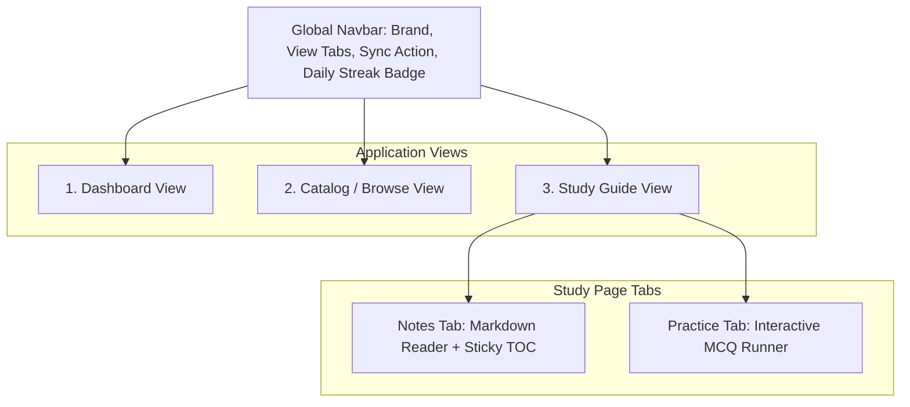

# LearnersGuide: Platform Specification & Design Blueprint

> **Document Version**: 1.0.0  
> **Target Audience**: UI/UX Designers, Frontend Developers, Design Copilots  
> **Platform Overview**: A full-stack MERN platform that merges **rich Markdown study guides** with an **interactive MCQ practice engine** and a **longitudinal progress & mastery tracker**.

---

## 1. Executive Summary & Core Workflows

LearnersGuide solves the fragmentation between note-taking and concept testing. Instead of reading notes in one app and practicing flashcards or questions elsewhere, LearnersGuide integrates both into a single cohesive learning cycle:

```text
[Browse Catalog] ──> [Read Markdown Notes] ──> [Interactive Practice Quiz] ──> [Track Record & Mastery]
```

### Key Workflows:
1. **Learn (Study Mode)**: The user reads in-depth documentation written in standard `.md` files, with full support for syntax-highlighted code snippets, LaTeX mathematical formulas, tables, and alert callouts.
2. **Assess (Practice Mode)**: The user tests retention with topic-specific questions (MCQs with single/multiple choices, code analysis questions). Each question supports on-demand hints, instant scoring, and detailed explanations for every option.
3. **Analyze (Dashboard Mode)**: Tracks reading completion, quiz accuracy rates, daily learning streaks, subject mastery breakdowns, and automatically flags weak topics (score $< 70\%$) for targeted revision.
4. **Sync (Content Management)**: New topics and questions are authored locally in a `backend/content/` folder as `.md` and `.questions.json` files. A 1-click "Sync Notes" button in the UI scans and indexes them without needing server restarts or manual database entry.

---

## 2. Global Design & Component System Requirements

When drafting design ideas in Copilot, use the following design system rules:

| Attribute | Specification |
| :--- | :--- |
| **Palette Family** | Warm beige canvas, layered off-white cards, deep ink black typography and accents, soft warm stone borders. |
| **Canvas Background** | Warm beige / linen (`#f5f2ea`). Never pitch-black OLED or saturated purple gradients. |
| **Surface Cards** | Clean off-white (`#ffffff`), subtle beige cards (`#faf8f4`, `#ede7dc`). |
| **Borders & Dividers** | Soft warm stone (`#dfd8cb`, `#d5cebf`). Subtle 1px borders for structure. |
| **Typography** | Clean, legible sans-serif (`-apple-system`, `Inter`, `Segoe UI`). Deep ink black (`#141311`) for headings, charcoal stone (`#544f43`) for body. |
| **Primary Buttons / CTAs** | Solid deep black (`#181715`) with crisp white text (`#ffffff`), hover state `#2b2925`. |
| **Secondary Buttons** | Off-white (`#ffffff`) or light sand (`#ede7dc`) with stone borders (`#dfd8cb`) and dark text (`#181715`). |
| **Icons** | Lucide React stroke icons (16px / 20px). No raw emojis. |
| **Responsive Grid** | Fluid container max-width `80rem` (1280px) with mobile, tablet, and desktop breakpoints. |

---

## 3. Page-by-Page Functional Specifications



---

### View 1: Global Navigation Bar (Header)
A sticky top bar (`h-16`) present across all screens.

- **Brand Element (Left)**:
  - App Logo: Inverted dark square/rounded icon with a book symbol.
  - Title: "LearnersGuide" (bold, clean ink black).
  - Stack Badge: Small pill reading `"MERN"` with subtle border.
  - Interaction: Clicking returns to Dashboard view.
- **View Navigation Tabs (Center)**:
  - `"Dashboard"` button (with `LayoutDashboard` icon).
  - `"Study Guides"` button (with `Compass` icon).
  - Active State: Solid dark pill with white text or sharp underline.
  - Inactive State: Muted stone text with subtle hover background.
- **Utility Actions (Right)**:
  - **"Sync Notes" Button**: Calls `POST /api/topics/sync`. Shows loading spinner during scan and changes to a green checkmark `"Synced"` for 2.5 seconds on completion.
  - **Daily Streak Badge**: Pill displaying a flame icon + streak count (e.g., `"1 day"` / `"5 days"`).

---

### View 2: Learning Dashboard
The landing overview showing personal statistics, active progress, and recommendations.

1. **Hero Welcome Card**:
   - Status tag: `"Learning Dashboard"`.
   - Headline: Encouraging headline (e.g., *"Study Guides & Practice Record"*).
   - Summary description.
   - **"Continue Reading" CTA**: Dynamically displays the user's current in-progress or next uncompleted topic (e.g., `Continue: Caching Strategies →`).
   - **"Browse All Guides" CTA**: Navigates to Catalog.
2. **KPI Metrics Grid (4 Cards)**:
   - **Card 1 (Topics Completed)**: Completed count vs total (e.g. `2 / 5 topics`), visual percentage progress bar.
   - **Card 2 (Average Accuracy)**: Overall average quiz accuracy score (e.g. `85%`), number of quizzes attempted.
   - **Card 3 (Daily Streak)**: Consecutive days with practice activity (e.g. `3 days active`).
   - **Card 4 (Curriculum Categories)**: Count of active subjects (e.g. `3 categories`).
3. **Subject Mastery Section (Left Column)**:
   - Lists each subject/category (e.g., *Data Structures & Algorithms*, *Web Development*, *System Design*).
   - Shows topics completed vs total per subject.
   - Subject-specific average quiz score percentage badge.
   - Smooth horizontal progress fill bar.
4. **Recommended Practice / Weak Areas (Right Column)**:
   - Scans user quiz history for topics where score was $< 70\%$.
   - Displays topic title, category, and recorded accuracy percentage.
   - Clicking immediately opens that topic's practice quiz for revision.
   - If no weak areas exist, displays an empty state banner (*"Up to date. No weak areas flagged"*).

---

### View 3: Catalog & Search Page
The filterable directory of all available study materials.

1. **Header & Controls Bar**:
   - Page Title and description.
   - **Search Input**: Live client-side text filter matching topic title, summary, or tags.
   - **Difficulty Dropdown**: Filter by `All`, `Beginner`, `Intermediate`, `Advanced`.
   - **Category Pills**: Horizontal scrollable list of category chips (`All`, `Data Structures`, `Web Development`, `System Design`).
2. **Topic Card Grid**:
   - Responsive multi-column layout (1 col on mobile, 2 col on tablet, 3 col on desktop).
   - **Card Attributes**:
     - Category Pill (e.g., `"Data Structures & Algorithms"`).
     - Completion Status Badge:
       - *Completed*: Subtle sage green pill with checkmark.
       - *In Progress*: Sand/stone pill.
       - *Not Started*: Hidden or subtle default.
     - Title: Clear, bold typography.
     - Excerpt: 2-line truncated summary.
     - Metadata Footer: Estimated reading time (e.g., `15m read`), question count (e.g., `4 Qs`).
     - Action: Clickable `"Read →"` link opening Study Guide view.

---

### View 4: Study Guide Page (Reader Mode)
The main reading interface for markdown documents.

1. **Topic Action Header**:
   - `"Back to Guides"` button with left arrow icon.
   - Metadata breadcrumb: Category tag, estimated read time.
   - Large Topic Heading ($H_1$).
   - **Bookmark Toggle**: Bookmark icon button (toggles active state and saves to user progress).
   - **Mark Complete Toggle**: Button toggles reading status between `reading` and `completed` with checkmark icon.
2. **Mode Switcher Tabs**:
   - `"Study Notes"` tab (shows markdown document + TOC).
   - `"Practice Questions (N)"` tab (opens MCQ runner).
3. **Reader Layout (Two-Column Grid)**:
   - **Main Content Pane (75% width)**:
     - Renders complete markdown with custom components:
       - Code Blocks: Dark container `#181715`, language tag, and a 1-click **"Copy Code"** button.
       - Tables: Styled responsive tables with alternating row backgrounds.
       - LaTeX Formulas: Ingested via KaTeX (e.g. $\mathcal{O}(\log n)$, $E = mc^2$).
       - GitHub-style Alerts: Custom alert boxes for `[!NOTE]`, `[!TIP]`, `[!IMPORTANT]`, `[!WARNING]`.
     - **Bottom Quiz Launch Card**: Placed at the bottom of the reading notes: *"Finished reading? Test your recall with N questions"*, with a primary button to launch the quiz.
   - **Sticky Table of Contents (25% width)**:
     - Automatically extracted from $H_1$, $H_2$, $H_3$ headings.
     - Intersection Observer scroll-spy (highlights current heading as the reader scrolls).
     - Clickable items to smoothly jump directly to any section.

---

### View 5: Interactive MCQ Practice Engine
The self-assessment interface.

1. **Practice Header**:
   - Topic title and subtitle.
   - Live Question Counter: e.g., `"2 / 4 answered"`.
   - Score Banner (Post-Submission): Shows percentage score (e.g. `"Score: 100% (4/4)"`).
2. **Question Cards**:
   - Question number badge (1, 2, 3...) and difficulty label (`Easy`, `Medium`, `Hard`).
   - Question prompt (formatted text / code snippet).
   - **On-Demand Hint**: `"Show Hint"` button reveals a collapsible hint card without spoiling the answer.
   - **Choice Option Buttons (A, B, C, D)**:
     - Letter badge on the left (`A`, `B`, `C`, `D`).
     - Option text.
     - **State: Idle**: Off-white button with stone border.
     - **State: Selected (Pre-submit)**: Black border with solid black letter badge and beige highlight.
     - **State: Correct (Post-submit)**: Muted sage green border & background with a green checkmark icon.
     - **State: Wrong (Post-submit)**: Muted terracotta/rust border & background with a red cross icon.
     - **State: Unselected Other (Post-submit)**: Dimmed opacity.
3. **Post-Submission Explanation Card**:
   - Automatically slides open beneath each question after submission.
   - Highlights the correct reasoning, why edge cases matter, and concept reminders.
4. **Assessment Footer Actions**:
   - Pre-submission: Primary `"Submit Assessment →"` button (disabled until answers are chosen).
   - Post-submission:
     - Celebration Confetti: Fires canvas confetti when score is $\ge 70\%$.
     - `"Retry Assessment"` button with reload icon.
     - `"Return to Notes"` button with book icon.

---

## 4. Content Storage & Markdown Authoring Specification

Study notes are stored directly as files in the repository under `backend/content/`:

```text
backend/content/
├── dsa/
│   ├── binary-search.md
│   └── binary-search.questions.json
├── web-dev/
│   ├── react-state-and-effects.md
│   └── react-state-and-effects.questions.json
└── system-design/
    ├── caching-strategies.md
    └── caching-strategies.questions.json
```

### 1. Markdown Frontmatter Schema (`.md`)
Every `.md` file starts with YAML frontmatter:

```markdown
---
title: "Binary Search & Divide and Conquer"
category: "Data Structures & Algorithms"
difficulty: "Intermediate"
tags: ["arrays", "binary-search", "algorithms"]
summary: "Master binary search patterns, integer overflow guards, and search space reduction."
estimatedMinutes: 15
order: 1
---

# Binary Search & Divide and Conquer

Content written in Markdown here...
```

### 2. Practice Questions Schema (`[slug].questions.json`)
Companion question bank linked by filename:

```json
[
  {
    "id": "bs_q1",
    "prompt": "What is the worst-case time complexity of binary search on a sorted array of size n?",
    "type": "mcq",
    "difficulty": "Easy",
    "options": [
      { "id": "a", "text": "O(1)", "isCorrect": false },
      { "id": "b", "text": "O(log n)", "isCorrect": true },
      { "id": "c", "text": "O(n)", "isCorrect": false },
      { "id": "d", "text": "O(n log n)", "isCorrect": false }
    ],
    "hint": "Think about halving the remaining search space at every step.",
    "explanation": "At each step, half of the array is eliminated, taking at most log2(n) iterations."
  }
]
```

---

## 5. Backend REST API Endpoints

| Method | Endpoint | Description |
| :--- | :--- | :--- |
| `GET` | `/api/topics` | Returns list of all topics with read status and question counts. |
| `GET` | `/api/topics/:slug` | Returns topic metadata, full markdown text, and parsed TOC headings. |
| `POST` | `/api/topics/sync` | Rescans `backend/content/` folder and syncs metadata to DB / cache. |
| `GET` | `/api/questions/topic/:slug` | Returns questions for practice (sanitized without `isCorrect` to prevent cheating). |
| `POST` | `/api/questions/evaluate` | Evaluates submitted choices, calculates percentage, logs attempt, returns explanations. |
| `GET` | `/api/progress/dashboard` | Aggregated analytics: total completed, accuracy %, streak, category mastery, weak areas. |
| `POST` | `/api/progress/topic-status` | Updates topic read status (`reading` / `completed`), bookmark, and notes. |
| `GET` | `/api/health` | Service health status and database connectivity indicator. |

---

## 6. Design Handoff Checklist for Redesigns

When you generate or refine designs with Copilot, ensure the mockups specify:
- [ ] **Color Tokens**: Exact hex codes for surfaces, borders, text, and active states.
- [ ] **Component Spacing**: Padding (`p-4`, `p-6`), gap hierarchy (`gap-3`, `gap-5`), border radii (`rounded-xl`, `rounded-2xl`).
- [ ] **Question States**: Unselected, hover, active selection, correct answer, wrong answer.
- [ ] **Dark & Light Harmony**: Contrast ratios $\ge 4.5:1$ for all body text against beige/off-white backgrounds.
- [ ] **Mobile Responsiveness**: Stacking order for the split-pane study view and multi-column catalog grid.
