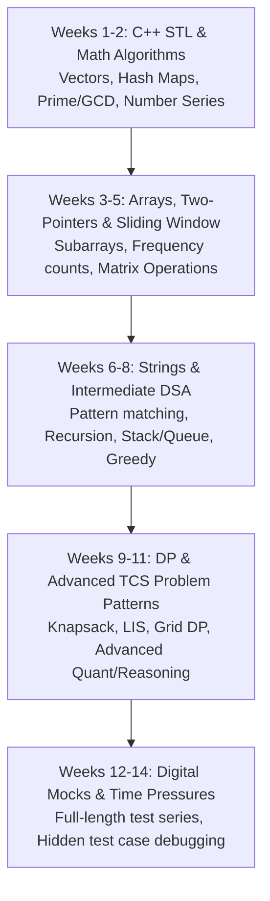

# TCS Digital Preparation Plan: C++ Track (7:00 AM – 9:00 AM Routine)

## Goal Description
Targeting the **TCS Digital Role** through the TCS NQT exam cycle. The strategy uses **C++ (with modern STL)**, capitalizing on your programming background while systematically rebuilding and advancing your DSA and aptitude skills. 

The schedule is built around a dedicated **7:00 AM – 9:00 AM** weekday morning window (10 hrs/week) and **5–6 hours** on weekends (10–12 hrs/week), maintaining a **60% Coding / 40% Cognitive** balance.

---

## Digital Role Targets & Strategy

| Component | Target Role Expectation | Strategy |
| :--- | :--- | :--- |
| **Coding Question 1** (Easy-Medium, 15-20 min) | **100% Test Cases Passed** | Master common patterns: Array/String manipulation, Number theory, Frequency mapping. |
| **Coding Question 2** (Medium-Hard, 30-35 min) | **All or Majority Test Cases Passed** | Master Dynamic Programming, 2D Arrays/Matrices, Greedy, Graph/Tree traversals. |
| **Advanced Cognitive** | High accuracy | Advanced Quant (P&C, Probability, Geometry) & Advanced Reasoning (Puzzles, Arrangements). |
| **Foundation Cognitive** | Speed & baseline qualification | Solve in minimal time without negative marking pitfalls. |

---

## Daily Schedule Structure (Mon – Fri: 7:00 AM – 9:00 AM)

By dedicating 7:00 AM to 9:00 AM before office hours, your mind is fresh and unburdened by workday fatigue:

```
┌────────────────────────────────────────────────────────────────────────┐
│  7:00 AM – 7:45 AM (45 mins) : Aptitude & Reasoning (40% Weightage)    │
│  • Concept learning (15 mins) + 10-12 timed practice questions (30 min)│
├────────────────────────────────────────────────────────────────────────┤
│  7:45 AM – 9:00 AM (75 mins) : C++ Coding & DSA (60% Weightage)        │
│  • Problem 1 (TCS Q1 Style): 25 mins (Implementation/Strings/Arrays)   │
│  • Problem 2 (TCS Q2 Style): 40 mins (DSA / Edge cases / Optimization) │
│  • 10 mins: Note down mistakes & time/space complexity analysis        │
└────────────────────────────────────────────────────────────────────────┘
```

---

## Weekend Timetable (Saturday & Sunday: 5–6 Hours)

Divided into two focused shifts to prevent burnout:

### Morning Shift (9:00 AM – 12:00 PM: 3 Hours)
* **Focus: C++ STL & Core DSA Deep-Dive**
  * Vector, `unordered_map`, `map`, `set`, `priority_queue`, algorithms (`sort`, `lower_bound`, `reverse`).
  * Implement and solve 3–4 complex problems (Prefix sums, 2D DP, Binary search variants).

### Evening Shift (4:00 PM – 6:30 PM: 2.5 Hours)
* **Focus: Advanced Quantitative & Timed Mock**
  * **Saturday**: Advanced Quant & Puzzles (Permutations, Combinations, Probability, Seating Arrangements).
  * **Sunday**: 1 Full-Length Timed Sectional Mock (Aptitude + Coding) under strict exam conditions, followed by error log review.

---

## Phase-wise Curriculum (C++ Track)



### 1. C++ STL & Problem Patterns Roadmap
* **Week 1–2**: Rapid STL refresh (`std::vector`, `std::pair`, `std::unordered_map`, `std::unordered_set`, `std::algorithm`). Math foundations: modulo arithmetic, prime checks (Sieve), GCD, decimal-to-any-base conversions.
* **Week 3–5**: Arrays, Two-Pointer technique, Sliding Window, Prefix Sums, Matrix manipulations (rotations, spirals, diagonal traversals).
* **Week 6–8**: Strings & Hashing (Anagrams, Palindromes, Substrings), Stacks (Parentheses, Next Greater Element), Greedy algorithms.
* **Week 9–11**: Dynamic Programming patterns (0/1 Knapsack variations, Coin Change, Longest Increasing Subsequence, Grid Paths) & Backtracking.

### 2. Cognitive Roadmap (Aptitude & Reasoning)
* **Week 1–4 (Foundations)**: Number Systems, Percentages, Profit & Loss, Ratio & Proportion, Blood Relations, Coding-Decoding, Direction Sense.
* **Week 5–8 (Core Aptitude)**: Time & Work, Speed-Time-Distance, Mixtures, Syllogisms, Circular & Linear Seating Arrangements.
* **Week 9–12 (Advanced Sections for Digital)**: Permutations & Combinations, Probability, Geometry & Mensuration, Data Sufficiency, Critical Reasoning.

---

## Week 1 Day-by-Day Action Plan (Starting Tomorrow)

| Day | 7:00 AM – 7:45 AM (Aptitude) | 7:45 AM – 9:00 AM (C++ Coding) |
| :--- | :--- | :--- |
| **Day 1 (Mon)** | Number Systems: Divisibility rules, Unit digit, Remainder theorem | C++ STL Refresh: `vector`, `cin`/`cout` fast I/O, parsing inputs without size |
| **Day 2 (Tue)** | LCM & HCF concepts & word problems | Number Theory Coding: Prime factorisation, Sieve of Eratosthenes, GCD |
| **Day 3 (Wed)** | Percentages: Fraction-percentage conversions & base shift | Array Basics in C++: Leaders in array, Equilibrium index, Array rotation |
| **Day 4 (Thu)** | Profit & Loss: Marked price, Discount, Successive discounts | Two Pointers: Segregate 0s and 1s, Pair with target sum, Container with most water |
| **Day 5 (Fri)** | Coding-Decoding: Letter & number patterns | Prefix Sum & Sliding Window: Maximum sum subarray of size K, Subarray with sum 0 |
| **Saturday** | **Aptitude (2 hrs)**: Blood Relations + Directions<br>**Coding (3.5 hrs)**: Hashing using `unordered_map` & `unordered_set` (Frequency counter, Find duplicates) |
| **Sunday** | **Coding Timed Drill (2.5 hrs)**: 3 TCS NQT past coding questions in C++<br>**Aptitude Revision (2.5 hrs)**: Week 1 quiz + Error notebook update |

---

## Workspace Setup (`f:\TCS NQT PREP`)

We will scaffold the workspace with:
1. `coding/` subdirectories organized by topic, with sample C++ starter templates and solutions.
2. `aptitude/` notes with key formulas and shortcut tricks.
3. `notes/error_tracker.md` to track tricky questions and edge cases.
